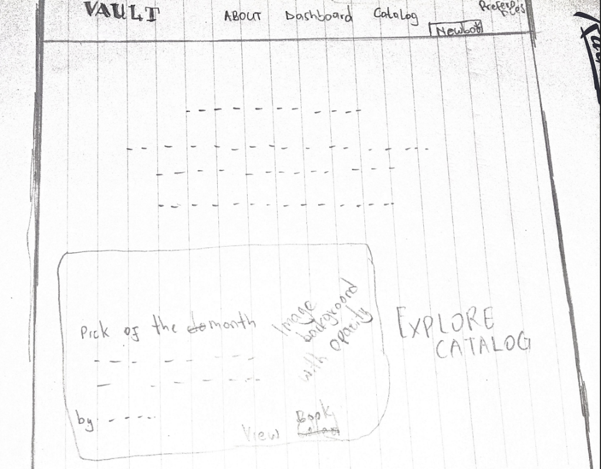
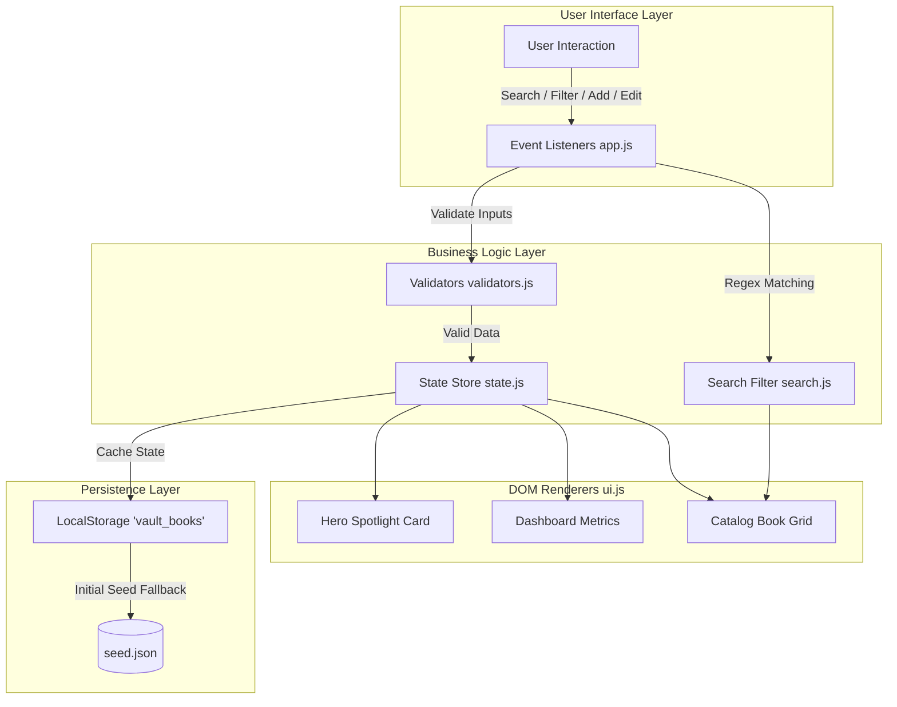

# Books & Notes Vault

A curated digital archive and reading catalog dedicated to world-renowned books that inspired masterpiece movies, series, and cultural adaptations. Built entirely with Vanilla HTML5, modern CSS3, and ES6 Modules with zero external dependencies.

---

## Live Links
- **Live Application**: [https://kingsleykipkoech.github.io/books-and-notes-vault/](https://kingsleykipkoech.github.io/books-and-notes-vault/)
- **Source Code**: [https://github.com/kingsleykipkoech/books-and-notes-vault](https://github.com/kingsleykipkoech/books-and-notes-vault)
- **Feature Verification**: [https://kingsleykipkoech.github.io/books-and-notes-vault/test.html](https://kingsleykipkoech.github.io/books-and-notes-vault/test.html)

---

## Project Vision

The Books & Notes Vault bridges literature and cinema. Great films—from Francis Ford Coppola's *The Godfather* to David Fincher's *Fight Club* and Peter Jackson's *The Lord of the Rings*—started as written words. This application preserves that lineage, giving readers and film lovers a dedicated personal space to catalog adapted classics, record reading metrics, log quotes, and curate their own spotlight collection.

---

## UI Layout Sketches & Wireframes

### Initial Concept Sketch
Original paper wireframe and layout planning for the vault interface, spotlight card, and navigation structure.

<p align="center">
  
</p>

### 1. Hero Spotlight Layout
A balanced two-column hero section anchored along a shared bottom baseline with ambient gold backlighting.

```text
+----------------------------------------------------------------------------------------------------+
|  [LOGO] VAULT              Featured   Dashboard   Catalog   About   Preferences      [+ Add Book]  |
+----------------------------------------------------------------------------------------------------+
|                                                                                                    |
|    .----------------- SPOTLIGHT CARD -----------------.      .------------- HERO CONTENT ----------.  |
|    |                                                  |      |                                     |  |
|    |   +--------------+   MY BEST PICK                |      |  FROM BOOKS WRITTEN                 |  |
|    |   |              |                               |      |  TO CREATING TOP MOVIES & SHOWS.    |  |
|    |   |  BOOK COVER  |   The Godfather               |      |                                     |  |
|    |   |   (2:3 ratio)|   by Mario Puzo               |      |  "Spiced and spiced top shows."     |  |
|    |   |  object-fit: |                               |      |                                     |  |
|    |   |   contain    |   The iconic mafia chronicle  |      |  World's top books that was used to |  |
|    |   |              |   that inspired Coppola's     |      |  make an absolute masterpiece.      |  |
|    |   |  No cutoff   |   masterpiece franchise.      |      |                                     |  |
|    |   +--------------+                               |      |  [ Explore Catalog ] [ Export JSON ]|  |
|    |                      View Catalog ->             |      |  [ Import JSON ]                    |  |
|    '--------------------------------------------------'      '-------------------------------------'  |
|                              (Both columns anchored along the bottom baseline)                     |
+----------------------------------------------------------------------------------------------------+
```

### 2. Catalog & Card Anatomy
A responsive auto-fill grid displaying individual book cards with custom actions.

```text
+----------------------------------------------------------------------------------------------------+
|                                         EXPLORE CATALOG                                            |
|                          [ Search by title, author, or keyword (/) ]                               |
|                                                                                                    |
|                 ( All )  ( Crime )  ( Fantasy )  ( Drama )  ( Sci-Fi )  ( Horror )                 |
|                                                                                                    |
|    +-----------------------+   +-----------------------+   +-----------------------+               |
|    | +-------------------+ |   | +-------------------+ |   | +-------------------+ |               |
|    | |    Cover Image    | |   | |    Cover Image    | |   | |    Cover Image    | |               |
|    | |    (2:3 ratio)    | |   | |    (2:3 ratio)    | |   | |    (2:3 ratio)    | |               |
|    | +-------------------+ |   | +-------------------+ |   | +-------------------+ |               |
|    | The Hunger Games      |   | The Shining           |   | Jurassic Park         |               |
|    | by Suzanne Collins    |   | by Stephen King       |   | by Michael Crichton   |               |
|    | 374 pages * ISBN      |   | 656 pages * ISBN      |   | 448 pages * ISBN      |               |
|    | --------------------- |   | --------------------- |   | --------------------- |               |
|    | DYSTOPIAN [Edit][Del] |   | HORROR    [Edit][Del] |   | SCI-FI    [Edit][Del] |               |
|    +-----------------------+   +-----------------------+   +-----------------------+               |
+----------------------------------------------------------------------------------------------------+
```

### 3. Compact Add & Edit Modal
A streamlined dialog constrained to the viewport height to eliminate awkward vertical scrolling.

```text
+---------------------------------------+
|  Add Book                             |
|                                       |
|  Title *                              |
|  [ Clean Architecture               ] |
|                                       |
|  Author *                             |
|  [ Robert C. Martin                 ] |
|                                       |
|  Category                             |
|  [ Software Architecture            ] |
|                                       |
|  Pages                  ISBN          |
|  [ 432               ]  [ 978-013449] |
|                                       |
|  Synopsis / Notes                     |
|  [ Practical guide to system design ] |
|                                       |
|  [X] Feature as your best Pick        |
|                                       |
|  Cover Image                          |
|  + - - - - - - - - - - - - - - - - -+ |
|  |   Choose image from device       | |
|  + - - - - - - - - - - - - - - - - -+ |
|                                       |
|                 [ Cancel ]  [ Save ]  |
+---------------------------------------+
```

---

## Application Architecture

The application follows a unidirectional data flow with distinct layers for state, storage, rendering, and validation.



---

## Features & Capabilities

| Feature | Technical Implementation | Purpose |
| :--- | :--- | :--- |
| **Hero Spotlight** | `updateHeroSpotlight()` in `ui.js` | Highlights the featured book with cover, title, author, and synopsis. Supports custom spotlight designation. |
| **Full CRUD** | `addBook`, `updateBook`, `removeBook` in `state.js` | Complete library management with persistent state across browser sessions. |
| **Live Search** | RegExp filter in `search.js` | Real-time search across titles, authors, categories, and synopsis text with error protection. |
| **Keyword Highlight** | String replace with `<mark>` tags | Instantly highlights search term matches within titles and author names. |
| **Dynamic Tags** | Category extraction from active books | Automatically generates category filter buttons based on active entries. |
| **Reading Analytics** | Array reduction in `ui.js` | Computes total volumes, total pages, and average pages per volume in real time. |
| **Preferences & Motto**| LocalStorage with HTML fallback | Allows customizing the hero banner quote and backing up data. |
| **JSON Export / Import**| Blob download & FileReader API | Full data backup and portable restore from JSON files. |
| **Keyboard Navigation**| Global `keydown` listeners | `/` to search, `N` for new book dialog, and `Esc` to close modals. |

---

## File Structure

```text
books-and-notes-vault/
├── index.html              Main semantic HTML5 application structure
├── seed.json               Default library collection (11 adapted classics)
├── test.html               Feature verification suite
├── README.md               Project documentation and architectural sketches
├── assets/                 Optimized cover images and vector artwork
│   ├── book-cover.jpg
│   ├── fightclub.jpg
│   ├── forestgump.jpg
│   ├── godfather.jpg
│   ├── heart.jpg
│   ├── history.jpg
│   ├── hunger.jpg
│   ├── jurrasic.jpg
│   ├── lamb.jpg
│   ├── princess.jpg
│   ├── rings.jpg
│   ├── shining.jpg
│   └── wireframe-sketch.png
├── scripts/                Modular ES6 JavaScript components
│   ├── app.js              Application lifecycle, event routing, and modals
│   ├── search.js           RegEx search matching and text highlighting
│   ├── state.js            Central in-memory state store
│   ├── storage.js          LocalStorage synchronization and JSON handling
│   ├── ui.js               DOM renderers for catalog, spotlight, and dashboard
│   └── validators.js       Form field validation rules
└── styles/                 Scoped CSS3 design system
    ├── main.css            Root color tokens, typography, and resets
    ├── nav.css             Fixed glassmorphic top navigation bar
    ├── hero.css            Hero grid, ambient glow, and spotlight card
    └── vault.css           Catalog grid, stats counters, and modal layouts
```

---

## Feature Verification Suite

An in-browser verification suite is included at `test.html`. It tests 14 core functional requirements across 4 categories:

1. **Search & Filters**: Multi-field query matching, category isolation, broken regex resilience, and visual mark highlighting.
2. **Form Validation**: Acceptance of clean input, rejection of empty titles, rejection of empty authors, and detection of malformed ISBN formats.
3. **Vault Data & Storage**: Initial state loading, record addition with notes/spotlight flags, record editing, and removal.
4. **Dashboard Calculations**: Accurate summation of total pages and computation of average page density.

Access the test runner directly at [test.html](https://kingsleykipkoech.github.io/books-and-notes-vault/test.html) or via the **Run Tests file** link in the site footer.

---

## Author

- **Kingsley Kipkoech**
  - GitHub: [https://github.com/kingsleykipkoech](https://github.com/kingsleykipkoech)
  - Project Repository: [https://github.com/kingsleykipkoech/books-and-notes-vault](https://github.com/kingsleykipkoech/books-and-notes-vault)
